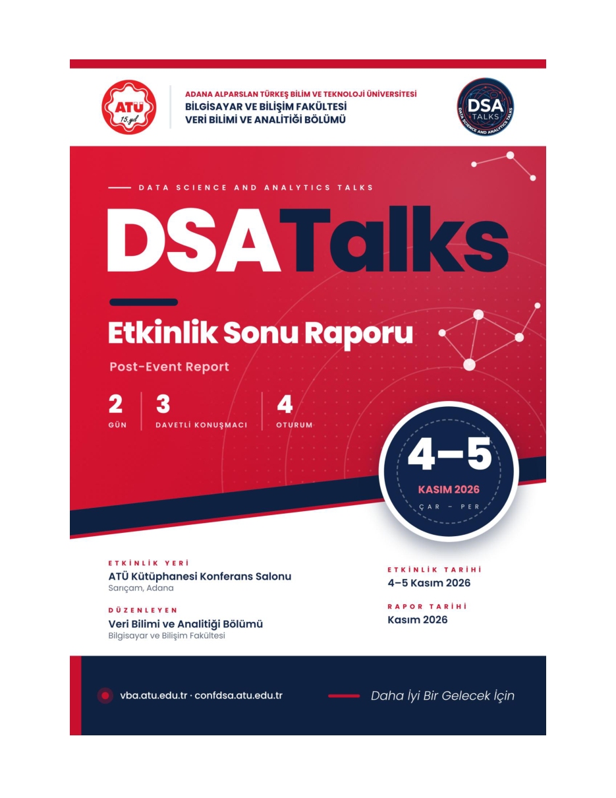

# DSATalks 2026 Event Report

Post-event report of **DSATalks 2026**, held on **4–5 November 2026** at the ATÜ Library Conference Hall, Adana Alparslan Türkeş Science and Technology University. Organised by the Department of Data Science and Analytics, Faculty of Computer and Informatics.

**[Read the report (PDF)](DSATalks-2026-Event-Report.pdf)**

## At a glance

| | |
| --- | --- |
| Dates | 4–5 November 2026 |
| Venue | ATÜ Library Conference Hall, Sarıçam, Adana |
| Programme | 2 days · 3 invited speakers · 4 sessions |
| Feedback | 584 session responses · weighted satisfaction 4.72 / 5 |

## What's inside

- Message from the Organising Committee
- Honorary, Organising and Programme Committees
- Announcement and communication channels
- Event programme and evaluation (survey results)
- Summaries of the sessions
- Event album

## Related

- Photo and video album: https://confdsa.github.io/DSATalks-2026-Album/
- Event website: https://confdsa.atu.edu.tr
- Department website: https://vba.atu.edu.tr
